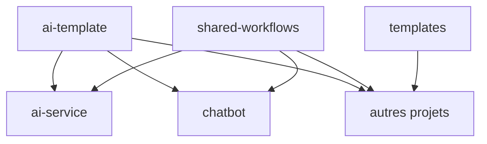

# tozano-ai-labs

Organisation dédiée aux projets IA construits autour d'un socle commun.

## Écosystème

- **[ai-template](https://github.com/tozano-ai-labs/ai-template)** : socle commun (règles, templates, agents, skills, documentation RGPD/sécurité IA)
- **[ai-service](https://github.com/tozano-ai-labs/ai-service)** : service IA
- **[chatbot](https://github.com/tozano-ai-labs/chatbot)** : interface chatbot
- **[shared-workflows](https://github.com/tozano-ai-labs/shared-workflows)** : workflows GitHub Actions partagés
- **[templates](https://github.com/tozano-ai-labs/templates)** : templates de dépôts

## Dépôts

| Dépôt | Description |
| --- | --- |
| [ai-template](https://github.com/tozano-ai-labs/ai-template) | Socle commun, règles et templates |
| [ai-service](https://github.com/tozano-ai-labs/ai-service) | Service backend IA |
| [chatbot](https://github.com/tozano-ai-labs/chatbot) | Application chatbot |
| [shared-workflows](https://github.com/tozano-ai-labs/shared-workflows) | Workflows GitHub Actions réutilisables |
| [templates](https://github.com/tozano-ai-labs/templates) | Templates de création de dépôts |
| [.github](https://github.com/tozano-ai-labs/.github) | Configuration organisationnelle (ce dépôt) |

## Principes

- **InnerSource** : contributions ouvertes avec revue par *trusted committer*
- **Squash merge** obligatoire, historique lisible au format gitmoji
- **"Aucun changement sans test"**
- **RGPD & sécurité IA** intégrés par défaut
- **L'IA ne pousse jamais** : l'humain reste propriétaire de la livraison
